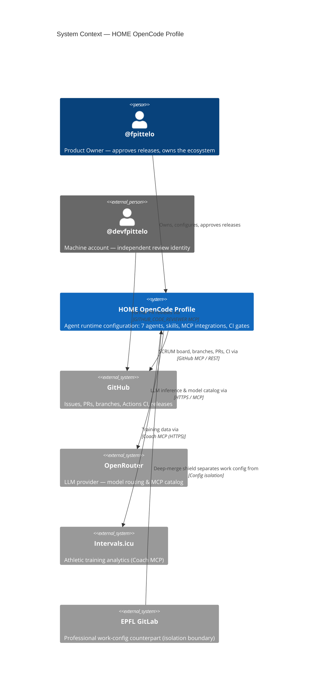
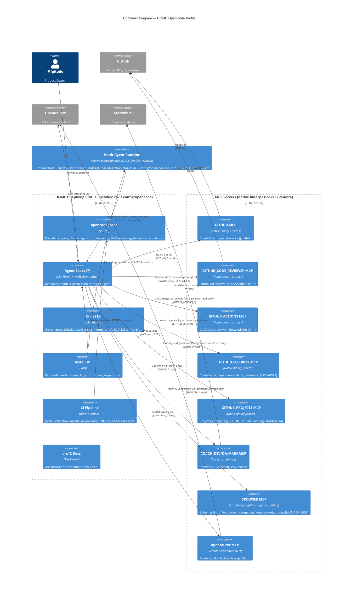

# Context & Building Blocks

*Status: consolidated from arc42 §1–§5 (seeded Sprint 03, STORY-02 #59; 3-view consolidation #342).*

## 1. Introduction & Goals

### 1.1 Requirements Overview

The **HOME OpenCode profile** is the agent runtime configuration that turns OpenCode into a governed, autonomous software-delivery team for the personal ecosystem of **Frederic Pitteloud (@fpittelo)**. It must:

- Provide **seven specialized agents** (architect, scrum-master, developer, code-reviewer, devops, cyber-security, coach) with precise mandates, model assignments, and permission boundaries.
- Integrate **MCP servers** (GitHub, GitHub Code Reviewer, Coach, OpenRouter) so agents operate on real platforms with real credentials — without ever handling secrets in plaintext.
- Enforce **deterministic, auditable SCRUM delivery** anchored to GitHub Issues, status labels, and sprint marker issues (board-as-SSOT, MADR-0013).
- Separate the HOME (personal) profile from the professional work profile (`opencode-work-config`) with zero cross-contamination.

### 1.2 Quality Goals

| Goal | Why it matters |
| :--- | :--- |
| Deterministic agent collaboration | Autonomous sprint delivery must not require human intervention except at release gates. |
| Auditability | Every delivery decision is traceable on the GitHub board (issue → PR → review → merge). |
| Security & privacy | Swiss nLPD compliance; zero secrets in repo; segregation of duties for reviews. |
| Zero-warning quality | Every merge passes CI with 0 warnings / 0 failures. |

### 1.3 Stakeholders & Their Goals

| Stakeholder | Goal |
| :--- | :--- |
| @fpittelo (Product Owner) | Governed autonomy: the squad delivers sprints autonomously; he approves only releases (tag `vX.Y.Z` on `main` — MADR-0017). |
| HOME SCRUM agents | Clear mandates, tool access scoped to their role, no permission leakage. |
| @devfpittelo (machine account) | Independent review identity enabling segregation of duties. |

## 2. Architecture Constraints

*SSOT: `home-governance` skill.*

| Constraint | Source | Impact |
| :--- | :--- | :--- |
| Single persistent trunk `main`; feature branches only merge into `main` (MADR-0017) | `home-governance` Rule 1–3 | All delivery automation is shaped around this lifecycle. |
| Zero-tolerance quality gate: CI with 0 warnings / 0 failures on every merge | `home-governance` Rule 4 | CI pipeline (JSONC validation + Gitleaks) is a merge precondition. |
| One explicit @fpittelo approval per release gates tagging `vX.Y.Z` on `main` (MADR-0017) | `home-governance` Rule 5 (normative) | Autonomous loop stops at merged PRs; releases are human-gated. |
| Swiss nLPD / FADP data protection; personal data local & encrypted | `home-governance` §2 | No personal data in config/docs; secrets via `{env:VAR}` interpolation only. |
| Board-as-SSOT: GitHub Issues + status labels + sprint marker issues (no file-based backlogs, no Projects v2; milestones historical only — MADR-0013) | Epic 3 (#57) refinement; MADR-0013 | SCRUM state machine maps onto the label taxonomy. |
| Segregation of duties: reviews by machine account `@devfpittelo` via `GITHUB_CODE_REVIEWER_*` MCP only | #52/#53, enforced by #68 | Permission patterns deny cross-access in both directions. |
| Technology stack: Python ≥ 3.12 (FastMCP/Pydantic v2) for MCP tooling; Rust stable for control planes | `home-governance` §3 | Harness images and future MCP servers follow these standards. |
| Language policy: software deliverables in English; personal topics in French | `home-governance` §2 | All config, docs, PRs, issues in English. |

## 3. System Context & Scope

### 3.1 Business Context

**Narrative:** the profile is operated by @fpittelo. Agents act on GitHub (delivery backbone) and OpenRouter (LLM routing) under scoped permissions. The Coach MCP connects to Intervals.icu for the athletic domain. The EPFL GitLab relationship is an *isolation* relationship: the work profile must never read or merge HOME data (strict boundary separation, `home-governance` §2).

### 3.2 Technical Context

| Channel | Protocol | Notes |
| :--- | :--- | :--- |
| GitHub MCP servers (`GITHUB`, `GITHUB_CODE_REVIEWER`, `GITHUB_ACTIONS`, `GITHUB_SECURITY`, `GITHUB_PROJECTS`) | stdio → native binary (pinned v2.0.2, SHA256-verified by `install.sh`) | Personal-access-token authenticated; SoD split per #68; extended toolsets + planning board per MADR-0011/MADR-0014. |
| Coach MCP servers (`COACH_DEV/QA/MAIN`) | stdio → Docker container | Environment-scoped (dev/qa/main) Intervals.icu access. |
| Playwright browser MCP (`BROWSER`, MADR-0009 #207) | stdio → npx `@playwright/mcp` (pinned 0.0.83; pin-time registry audit by `install.sh` — npx re-resolves per session) | Ephemeral-profile browser automation for user-journey verification against coach-web dev/qa lanes; loopback-origin allowlist; @developer/@devops only. |
| OpenRouter MCP (`openrouter`) | remote streamable-HTTP | OAuth handled by OpenCode on first use; no stored token. |
| LLM inference | HTTPS (OpenRouter API) | Model per agent via `openrouter/<model>` assignments. |
| Herdr agent runtime (MADR-0005, #148) | Unix socket `~/.config/herdr/herdr.sock` + real PTY panes | Technology Layer node on VIDAR — hosts OpenCode TUI panes, reports agent lifecycle (working/blocked/idle); pinned v0.9.3 binary installed by `install.sh`; strictly local (no SSH remote). |
| CI | GitHub Actions | JSONC validation + diff-scoped Gitleaks scan per PR (pinned gitleaks-action v3.0.0); full-history scan runs in the scheduled deep-validation workflow (MADR-0003). |

### 3.3 Scope Decisions

- **In scope:** agent definitions, permission model, MCP server wiring, skills library, install script, CI pipeline, SCRUM board automation, architecture documentation, Herdr agent-runtime integration (pinned binary install + documented integration-file lifecycle, MADR-0005).
- **Out of scope:** the OpenCode runtime itself (upstream product), MCP server implementations (separate repos, e.g. coach), EPFL work configuration (`opencode-work-config`), cloud infrastructure repos (`iaac-*`), Herdr's own internals (upstream product — this repo pins and installs the binary; it does not track Herdr-owned integration files).

## 4. Solution Strategy

The architecture follows four strategic pillars:

1. **Agent-spec-driven configuration.** Every agent is a Markdown file (`agents/<name>.md`) with YAML frontmatter (model, temperature, permission rules) and a prompt body defining its mandate. The configuration is data, not code — reviewable, diffable, and CI-validated.

2. **Skills as knowledge modules.** Domain knowledge (governance, SCRUM board operations, diagramming, IaC, TDD, …) lives in `skills/<name>/SKILL.md` and is activated contextually. This keeps agent prompts lean and knowledge versioned. CI enforces the skill inventory.

3. **MCP as the only integration layer.** Agents never touch platforms directly; all platform access (GitHub, Intervals.icu, OpenRouter) flows through scoped MCP servers with explicit per-agent permission patterns (allow/deny, last-match-wins). Secrets are provisioned via `{env:VAR}` interpolation from profile-scoped files (`.secrets-home.env` / `.secrets-work.env`, mode 600) sourced inside the `oc-home` / `oc-work` wrapper subshells (MADR-0010) — no global rc sourcing, no systemd import — and never stored in the repo. Bare `opencode` is unsupported for secret-bearing work.

4. **Board-as-SSOT delivery.** The SCRUM process is encoded in agent specs (`github-scrum-board` skill + #58 state machine) and executed against GitHub Issues/status labels/sprint marker issues (MADR-0013). The autonomous loop delivers into `main` (the trunk — MADR-0017); humans gate releases.

Key decisions are indexed in `docs/adr/README.md` (single MADR index — see `03-cross-cutting-and-security.md` §5; wired by STORY-03 #60).

## 5. Building Block View

### 5.1 Whitebox Overall System

### 5.2 Level 2 — Motivation & Explanation

| Building block | Responsibility | Key interfaces |
| :--- | :--- | :--- |
| `opencode.jsonc` | Single runtime configuration: `enabled_providers: ["openrouter"]`, `default_agent: "architect"` + built-in `build`/`plan` mode disabling (#149), MCP registry, `{env:VAR}` secret interpolation | OpenCode runtime schema (https://opencode.ai/config.json) |
| `agents/*.md` (7) | Role mandates, model assignments, permission boundaries (allow/deny, last-match-wins) | OpenCode agent loading; frontmatter schema |
| `skills/*/SKILL.md` (15) | Versioned domain knowledge activated on demand | Skill frontmatter (`name`, `description`) |
| `install.sh` | Path-independent installation (symlinks from `SCRIPT_DIR`) into `~/.config/opencode`; provisions `profiles.sh` with the `oc-home()` wrapper and migrates secrets to profile-scoped files (MADR-0010); installs the pinned `github-mcp-server` and Herdr binaries (SHA256-verified, idempotent) | Bash (per-pane wrapper subshells `oc-home` / `oc-work`, MADR-0010) |
| `.github/workflows/ci.yml` | Zero-warning gate: JSONC validation, agent/skill presence inventory, diff-scoped Gitleaks scan per PR (pinned gitleaks-action v3.0.0); full-history scan runs in the scheduled `deep-validation.yml` (MADR-0003) | GitHub Actions |
| MCP servers | Platform integration with credential isolation; SoD via separate server + machine account | MCP stdio (native binary / Docker / npx) / streamable-HTTP (remote) |
| Herdr runtime (MADR-0005) | Hosts OpenCode TUI panes as real PTYs; reports agent lifecycle (working/blocked/idle); sessions survive detach (`ctrl+b q` → `herdr`) and server restarts | `herdr` CLI (client/server), Unix socket `~/.config/herdr/herdr.sock`, integration plugins in `~/.config/opencode/` (untracked, Herdr-owned) |

**Permission model invariants (enforced since #68, extended by #108, #150):**
- `@code-reviewer`: `GITHUB_*: deny` then `GITHUB_CODE_REVIEWER_*: allow` — acts ONLY as `@devfpittelo`.
- All other agents: `GITHUB_*: allow` then `GITHUB_CODE_REVIEWER_*: deny` — cannot impersonate the reviewer.
- Global default-deny baseline (#150): `opencode.jsonc` denies `COACH_DEV_*` / `COACH_QA_*` / `COACH_MAIN_*` at the root `permission` level — built-in subagents (`explore`, `general`, `task`) and any unconfigured persona inherit zero Coach MCP access.
- `@coach` only: `COACH_DEV_*` / `COACH_QA_*` / `COACH_MAIN_*`: allow — Coach MCP is coach-only (SoD); `agents/coach.md` is the sole allow whitelist.
- All other agents: `COACH_DEV_*` / `COACH_QA_*` / `COACH_MAIN_*`: deny (explicit per-agent backstop of the global baseline).
- `@architect` and `@coach` only: `openrouter_*: allow`; all other agents `openrouter_*: deny` (supersedes #67's "all agents" rule).
- Global default-deny baseline (#207, MADR-0009): `opencode.jsonc` denies `BROWSER_*` at the root `permission` level — built-in subagents (`explore`, `general`, `task`) and any unconfigured persona inherit zero browser access.
- `@developer` and `@devops` only: `BROWSER_*: allow` — Playwright browser MCP (ephemeral profile, loopback-origin allowlist) for coach-web dev/qa user-journey verification; all other agents `BROWSER_*: deny` (explicit per-agent backstop).
- Global default-deny baseline (MADR-0011): `opencode.jsonc` denies `GITHUB_ACTIONS_*` and `GITHUB_SECURITY_*` at the root `permission` level.
- `GITHUB_ACTIONS_*`: `@devops` only for write operations (`actions_run_trigger`); `@developer` receives read-only triage tools (`actions_get`, `actions_list`, `get_job_logs`) with explicit deny on `actions_run_trigger`; all other agents deny.
- `GITHUB_SECURITY_*`: `@cyber-security` only, with `--read-only` flag enforced at process startup and raw secret redaction rules; all other agents deny.
- Global default-deny baseline (MADR-0014): `opencode.jsonc` denies `GITHUB_PROJECTS_*` at the root `permission` level.
- `GITHUB_PROJECTS_*`: the wildcard stays denied for every agent; `@architect` and `@scrum-master` hold the governed partial allow (`projects_get`, `projects_list`, `projects_write` — the consolidated planning tool) for OPTIONAL roadmap writes; all other agents deny. Since #339 the execution SSOT is the `status::*` labels + sprint markers — Projects v2 is a roadmap view, never a blocking dependency.
- The namespace-exclusivity invariant (COACH_* @coach-only #150; BROWSER_* @developer/@devops-only #207; GITHUB_ACTIONS_* / GITHUB_SECURITY_* MADR-0011; GITHUB_PROJECTS_* MADR-0014) is machine-enforced by `harness/config-validation/check_coach_exclusivity.py` (gate 9 of `harness/run-config-gate.sh` and a dedicated CI step in `ci.yml`).

**Mode gating invariants (enforced since #149):**
- `opencode.jsonc` sets `"default_agent": "architect"` — every OpenCode session launches into the governed Solution Architect persona (`agents/architect.md` declares `mode: primary`).
- Built-in `build` and `plan` modes are disabled (`"agent": { "build": { "disable": true }, "plan": { "disable": true } }`) — the TUI mode switcher offers governed HOME SCRUM agents only.

### 5.3 Level 3

Not required at this stage — the profile is configuration, not layered code. Component-level detail may be added for the harness (`harness/`) if it grows.
