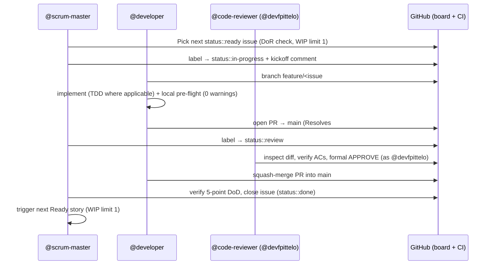

# 6. Runtime View

*Status: seeded (Sprint 03, STORY-02 #59). Lifecycle & DoD canon: `home-governance` §5–§7 — SSOT.*

## 6.1 Scenario: Autonomous Issue-by-Issue Delivery Loop

**Trigger:** a sprint marker issue is active with at least one `status::ready` issue, and @fpittelo has authorized the loop.

**Postconditions:** issue closed with full traceability (squash SHA, PR, CI run, review links); `main` advanced by exactly one squash commit.

**Failure modes:** pre-flight or CI failure → developer self-remediation (max 3 attempts, then `blocker::active` escalation to @architect per the circuit breaker).

## 6.2 Scenario: Release (human-gated, tag-from-trunk — MADR-0017)

**Trigger:** all sprint deliverables merged into `main`.

1. @fpittelo grants the release approval — **one explicit approval per release before tagging** (`home-governance` Rule 5 — SSOT).
2. @devops creates the release tag `vX.Y.Z` on `main` and publishes the GitHub Release via `GITHUB_RELEASES` (MADR-0016). No promotion PRs exist (MADR-0017 supersedes MADR-0012's promotion protocol).
3. @scrum-master runs board hygiene (audit, label cleanup, sprint-marker close, retrospective, next-sprint marker creation — MADR-0013).

## 6.3 Scenario: Architecture Change → Documentation Update

**Trigger:** any change to agents, skills, MCP servers, or policies.

1. @architect identifies affected arc42 sections via the update-trigger table (`arc42-documentation` skill §4).
2. The arc42 update travels **in the same feature branch and PR** as the change.
3. @code-reviewer verifies documentation parity alongside the code/config change.